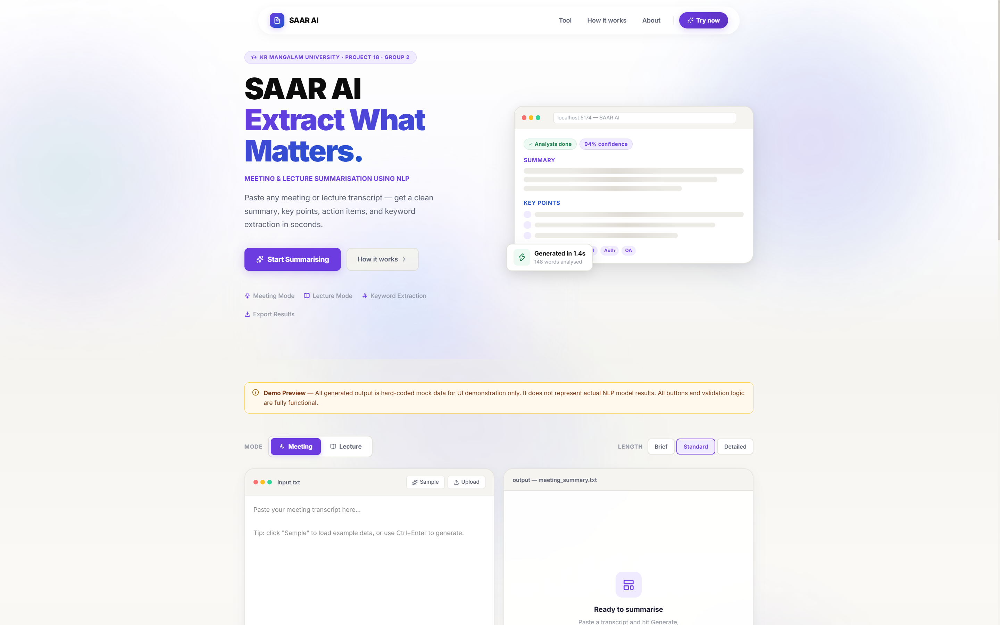
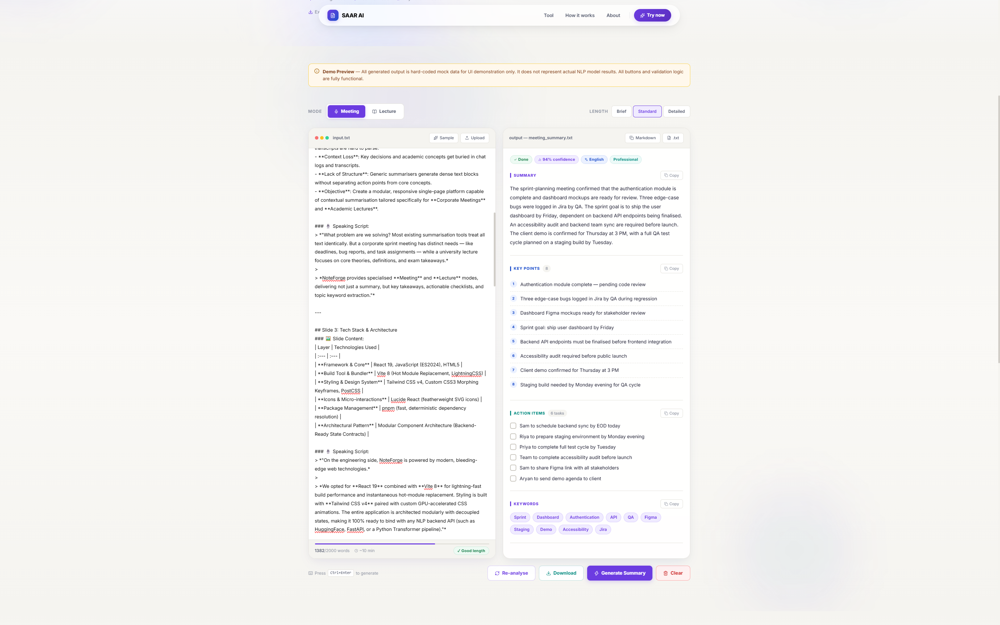
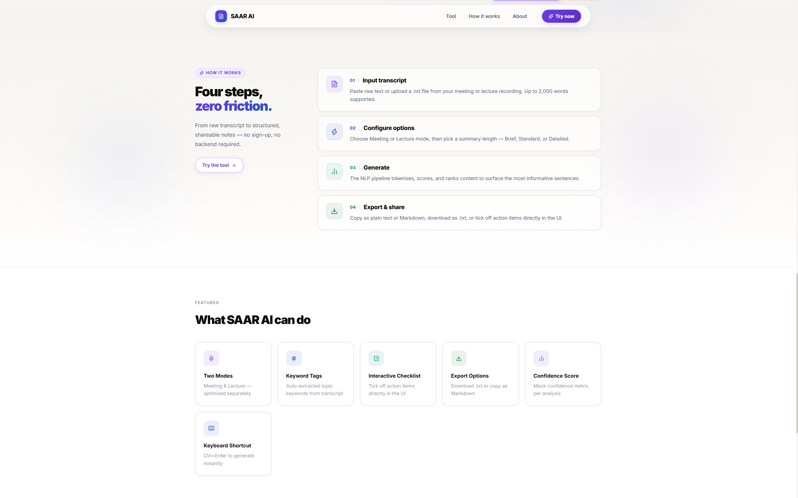
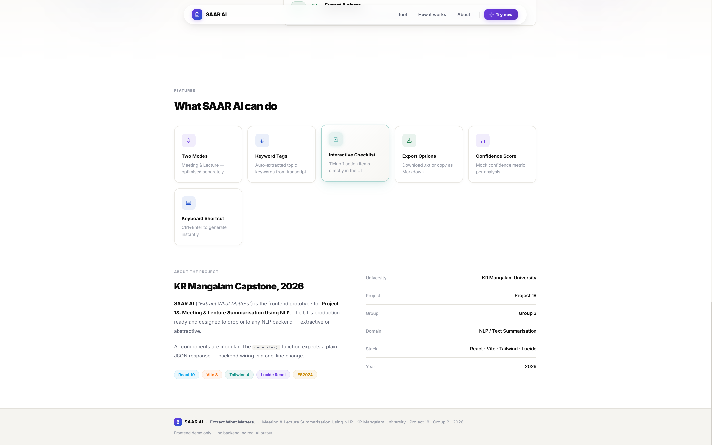

# SAAR AI — Extract What Matters.

> **Academic Title:** Meeting & Lecture Summarisation Using NLP  
> **Course:** NLP Capstone Project — Project 18 (Group 2)  
> **Institution:** School of Engineering and Technology, KR Mangalam University  
> **Repository:** [https://github.com/JUSSTTMEE07/SAAR-AI](https://github.com/JUSSTTMEE07/SAAR-AI)  
> **Development Status:** ✅ Frontend Prototype Implemented | ⏳ NLP Backend Integration Pending  

---

## 📌 Project Overview

**SAAR AI** is an intelligent, domain-adapted web application prototype built for **Meeting & Lecture Summarisation Using Natural Language Processing (NLP)**. 

Standard text summarisers treat all text identically. However, corporate sprint meetings require deadline tracking, task accountability, and blocker identification, whereas university lectures demand conceptual clarity, theoretical definitions, formula citations, and study takeaways.

**SAAR AI** addresses this gap by providing tailored workflows:
- **Meeting Mode:** Extract sprint goals, blockers, stakeholder responsibilities, and interactive action item checklists.
- **Lecture Mode:** Distill complex academic lectures into core concepts, theories, literature references, and revision points.

---

## ⚠️ Current Development Status

> **IMPORTANT NOTICE:**  
> The **Frontend Prototype** of SAAR AI is fully functional, responsive, and backend-ready.  
> The **NLP Backend Integration is currently PENDING**.  
> The summarisation results, key highlights, action items, keywords, and analytics currently rendered in this prototype are **demonstration previews utilizing structured mock datasets** to showcase the user experience, component contracts, and interface architecture. They should **not** be considered live NLP model inference results until the Python/FastAPI transformer backend is linked.

---

## ✨ Features

- **Dual Domain Workflows:**
  - *Meeting Mode*: Structured around agendas, blockers, and task owners.
  - *Lecture Mode*: Structured around concepts, definitions, and academic takeaways.
- **Floating Glassmorphic Header:** Transparent frosted-glass navigation bar (`backdrop-filter: blur(20px)`) with smooth hover lift and micro-tilt interactions.
- **Living Canvas (Organic Liquid Mesh):** GPU-accelerated multi-axis CSS keyframe morphing background that gently flows without harsh boundaries.
- **Comprehensive Input Studio:**
  - Direct transcript textarea input.
  - Plain `.txt` file upload support (drag-and-drop / file selector, max 500 KB).
  - Real-time word and character counter with interactive read-time indicators and dynamic validation chips (*Too short*, *Short*, *Good length*).
  - One-click *Sample Transcript* loader for instant demonstration.
- **Multi-Level Output Studio:**
  - Executive Abstract Summary.
  - Indexed Key Points for rapid scanning.
  - **Interactive Clickable Action Item Checklist:** Direct in-UI task completion with strike-through animations.
  - **Auto-extracted Keyword Pills:** Highlighting core topic tags.
  - Analytics badges: Confidence score, detected language, reading level, and performance metrics.
- **Summary Length Control:** Switch between *Brief*, *Standard*, and *Detailed* modes.
- **Export & Portability:**
  - Instant formatted `.txt` report download (`saar-ai-[meeting/lecture]-summary.txt`).
  - One-click copy as GitHub/Notion-ready **Markdown (`.md`)**.
  - One-click copy for individual sections or full report text.
- **Power User Controls:** Instant summarisation trigger via `Ctrl + Enter` (or `Cmd + Enter`).
- **Fully Responsive & Accessible:** Optimized across mobile, tablet, desktop, and ultra-wide displays.

---

## 📸 Application Screenshots

> *All screenshots below showcase the **SAAR AI Frontend Prototype** running on `localhost`. Output text, scores, and checklists represent structured demonstration mock datasets.*

### 1. Landing Page & Hero Section
*Featuring the floating glassmorphic navbar, organic fluid liquid mesh background animation, and interactive quick-start CTA.*


### 2. Dual Studio Interface & Summariser Canvas
*Split-screen layout with `input.txt` editor on the left and live `output` analytics studio on the right.*


### 3. Generated Summary & Structured Key Takeaways
*Executive abstract summary with high-priority numbered key highlights extracted from the transcript.*


### 4. Interactive Action Items & Keyword Extraction
*Clickable task checklist with interactive strike-through state and topic keyword tags.*


---

| Layer | Technology | Details |
| :--- | :--- | :--- |
| **Frontend Framework** | **React 19** | Modern functional components, React Hooks (`useState`, `useEffect`, `useRef`, `useCallback`) |
| **Build Tool & Bundler** | **Vite 8** | Hot Module Replacement (HMR), LightningCSS optimization, ES modules |
| **Styling & Design System** | **Tailwind CSS v4 & PostCSS** | Modern utility-first CSS, custom CSS3 liquid keyframe animations, glassmorphism |
| **Icons** | **Lucide React** | Featherweight tree-shakable SVG icon library |
| **Package Management** | **pnpm** (with npm compatibility) | Fast, deterministic dependency management |
| **Language** | **JavaScript (ES2024)** | Modern asynchronous and functional JavaScript |

---

## 📁 Repository Structure

```text
SAAR-AI/
├── src/
│   ├── App.jsx             # Main application orchestrator & layout
│   ├── components.jsx      # Modular UI components (Navbar, Hero, Tool, HowItWorks, About, Footer)
│   ├── index.css           # Tailwind v4 import, custom liquid water keyframes & theme variables
│   └── main.jsx            # React 19 root bootstrap
├── .gitignore              # Production git ignore definitions (credentials, node_modules, dist)
├── index.html              # HTML5 entry point with SAAR AI branding & embedded SVG favicon
├── package.json            # Project dependencies and script declarations
├── pnpm-lock.yaml          # Pnpm lockfile
├── postcss.config.js       # PostCSS configuration for Tailwind CSS v4
├── PRESENTATION_SCRIPT.md  # Comprehensive presentation slide deck & speech script
├── README.md               # Project documentation
└── vite.config.js          # Vite build configuration
```

---

## 🚀 Installation & Local Setup

### Prerequisites
- **Node.js**: v18.0.0 or higher
- **pnpm** (recommended) or **npm**

### 1. Clone the Repository
```bash
git clone https://github.com/JUSSTTMEE07/SAAR-AI.git
cd SAAR-AI
```

### 2. Install Dependencies
```bash
# Using pnpm (recommended)
pnpm install

# Or using npm
npm install
```

### 3. Run Development Server
```bash
# Using pnpm
pnpm run dev

# Or using npm
npm run dev
```
Open your browser and navigate to `http://localhost:5173/` (or the port indicated in your console).

### 4. Build for Production
```bash
# Using pnpm
pnpm run build

# Or using npm
npm run build
```
The compiled, minified production assets will be generated in the `dist/` directory.

### 5. Preview Production Build
```bash
pnpm run preview
```

---

## 🔌 NLP Backend Integration Guide

The frontend architecture is modular and decoupled, adhering to a clean JSON API contract ready to connect with any backend NLP service (e.g., Python FastAPI running HuggingFace Transformers such as BART, T5, or PEGASUS).

### API Contract Example
In `src/components.jsx`, update the `generate()` function to connect to your live NLP inference service:

```javascript
const generate = async () => {
  if (!text.trim() || words < 10) return;
  setLoading(true);
  try {
    const response = await fetch("https://your-nlp-backend.api/v1/summarise", {
      method: "POST",
      headers: { "Content-Type": "application/json" },
      body: JSON.stringify({
        transcript: text,
        mode: mode,       // "Meeting" | "Lecture"
        length: length    // "Brief" | "Standard" | "Detailed"
      })
    });
    const data = await response.json();
    setResult(data);
  } catch (error) {
    setError("Failed to communicate with NLP inference engine.");
  } finally {
    setLoading(false);
  }
};
```

---

## 👥 Capstone Project Information

- **Institution:** School of Engineering and Technology, KR Mangalam University, Gurugram
- **Project Title:** Project 18: Meeting & Lecture Summarisation Using NLP
- **Team:** Group 2
- **Academic Year:** 2026
- **License:** ISC
